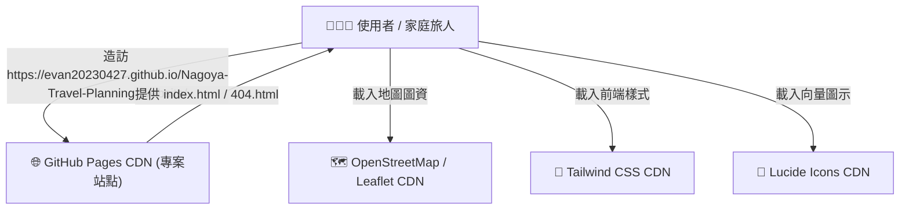
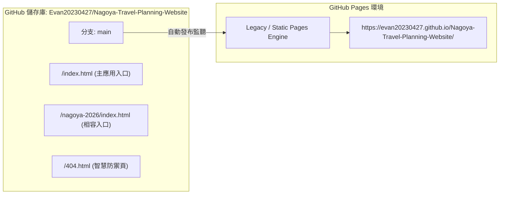
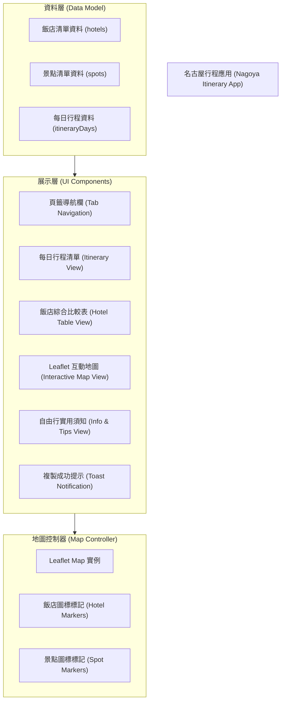
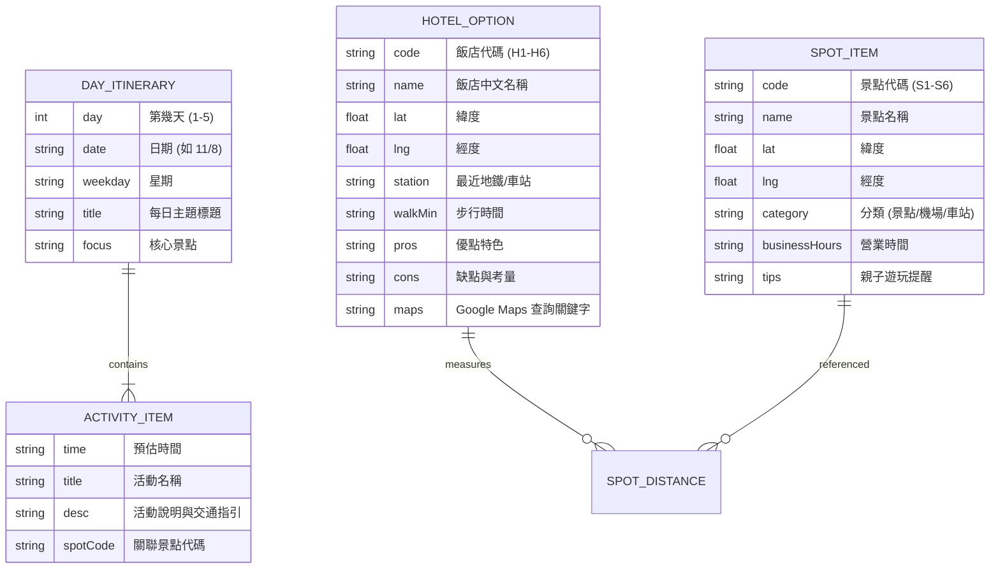
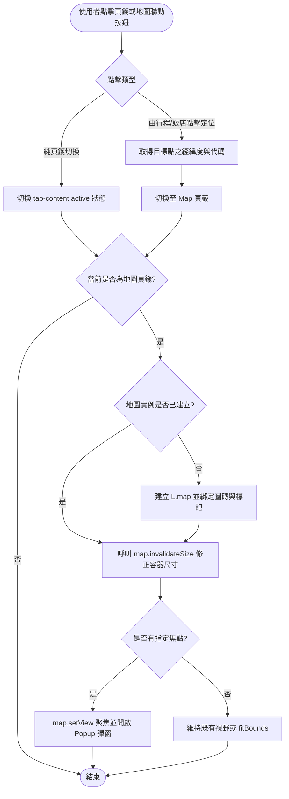
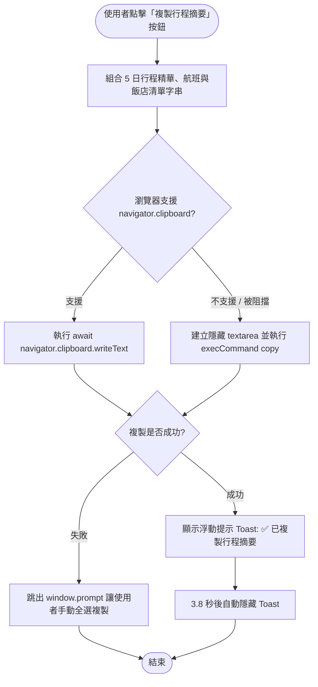
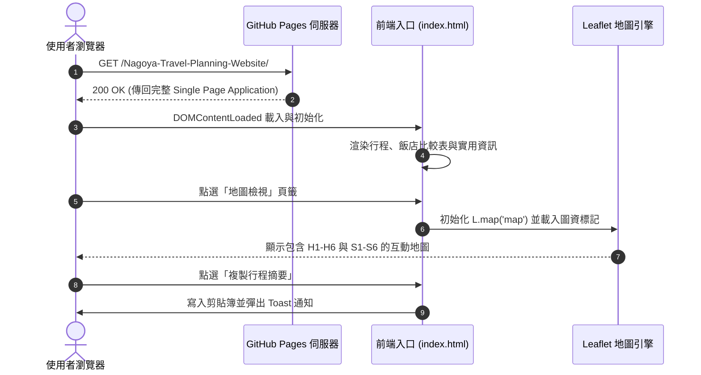
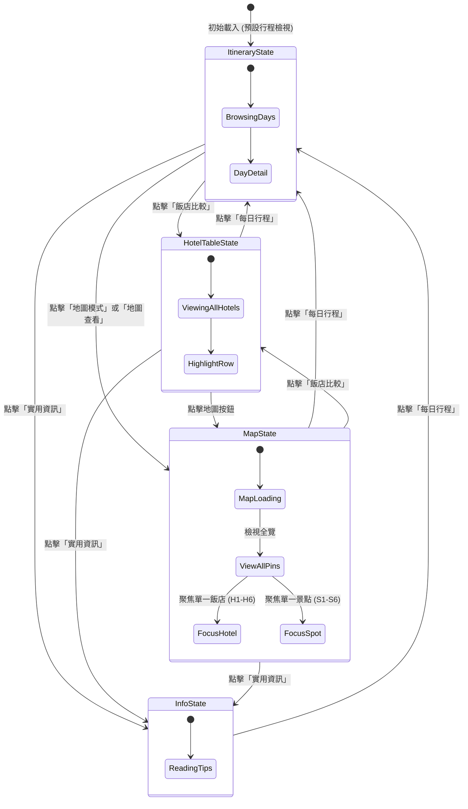

# 2026 名古屋 5 日親子自由行規劃網站 規格說明書 (spec.md)

## 1. 專案概述與問題診斷 (System Overview & Root Cause Analysis)

### 1.1 專案背景
本專案為「2026 名古屋 5 日親子自由行（2026/11/8 - 11/12）」之互動式行程指南與飯店地圖網站，託管於 GitHub Pages 靜態網站託管服務。

### 1.2 GitHub Pages 失效根本原因剖析 (Root Cause)
1. **儲存庫命名與 GitHub Pages 網址結構差異**：
   - 當儲存庫命名為 `<username>.github.io`（使用者網站）或綁定自訂頂級網域（如 `ai-sideproject.me`）時，網站根目錄為網域根路徑 `https://<domain>/`。
   - 當儲存庫為一般專案儲存庫（`Nagoya-Travel-Planning-Website`）且移除自訂網域改用免費用戶子網域時，GitHub Pages 的正式 URL 變更為**子路徑結構**：
     `https://evan20230427.github.io/Nagoya-Travel-Planning-Website/`
2. **絕對路徑轉址導致 404**：
   - 根目錄原本的 `index.html` 內包含：
     ```html
     <meta http-equiv="refresh" content="0;url=/nagoya-2026/">
     <a href="/nagoya-2026/">點此前往行程網站</a>
     ```
   - 由於 `/nagoya-2026/` 開頭為斜線（絕對路徑），瀏覽器會直接跳轉至根網域：
     `https://evan20230427.github.io/nagoya-2026/`
   - 該路徑跳脫了本儲存庫子目錄 `/Nagoya-Travel-Planning-Website/`，導致 GitHub Pages 回應 **HTTP 404 Not Found**。
3. **解決策略**：
   - **根目錄即應用（Zero-Redirect Single Page Application）**：將完整的名古屋行程指南與互動地圖直接部署於根目錄 [`index.html`](file:///C:/Users/TW-Evan.Chen/Nagoya-Travel-Planning-Website/index.html)，造訪 `https://evan20230427.github.io/Nagoya-Travel-Planning-Website/` 時立即可用，免除額外轉址與白屏延遲。
   - **舊路徑相容性保證**：保留 `nagoya-2026/index.html` 並同步內容，確保透過舊連結造訪的使用者依然能完整瀏覽。
   - **全域 404 智慧防禦**：建立 `404.html`，當使用者輸入任意錯誤路徑時自動導回本專案首頁。

---

## 2. 系統脈絡圖 (System Context Diagram)



---

## 3. 部屬與容器概觀 (Deployment Overview)



---

## 4. 模組架構與技術選型 (Architecture & Technology Stack)

| 模組領域 | 選用技術 / 函式庫 | 說明與理由 |
| :--- | :--- | :--- |
| **前端框架** | 原生 HTML5 + Vanilla JS (ES6+) | 輕量極速，零編譯步驟，GitHub Pages 原生免建置直接發布 |
| **樣式排版** | Tailwind CSS (CDN 執行期引擎) | 響應式排版（Mobile-First），適配手機單手操作與桌面大螢幕 |
| **地圖互動** | Leaflet.js v1.9.4 + OpenStreetMap | 免費開源地圖核心，無 Google Maps API Key 額度與外洩風險 |
| **圖示系統** | Lucide Icons v0.468.0 (UMD) | 高辨識度 SVG 圖示，清晰標記交通、飯店、景點與天氣 |
| **資料儲存** | 記憶體內建結構化 JSON 陣列 | 內嵌於腳本中，零伺服器依賴，支援離線與無網路快取 |

---

## 5. 前端模組關係圖 (Frontend Module Architecture)



---

## 6. 資料模型與 ER 圖 (Data Model & ER Diagram)



---

## 7. 關鍵業務流程圖 (Key Workflows)

### 7.1 頁籤切換與地圖重新計算流程



### 7.2 行程摘要複製至剪貼簿流程 (LINE 分享)



---

## 8. 序列圖 (Sequence Diagram)



---

## 9. 狀態圖 (State Diagram)



---

## 10. 虛擬碼 (Pseudocode)

```javascript
// 核心頁籤與地圖切換控制器
function switchTab(targetTabName):
    FOR EACH content IN document.querySelectorAll('.tab-content'):
        IF content.id == targetTabName:
            content.classList.add('active')
        ELSE:
            content.classList.remove('active')

    FOR EACH button IN document.querySelectorAll('[data-tab]'):
        IF button.dataset.tab == targetTabName:
            highlightActiveButton(button)
        ELSE:
            unhighlightInactiveButton(button)

    IF targetTabName == 'map':
        requestAnimationFrame(() => {
            initMapIfNeeded()
            map.invalidateSize() // 避免寬高計算錯誤導致灰屏
        })

// 地圖聚焦指定座標與開啟彈窗
function showOnMap(category, itemCode):
    target = findItemByCode(category, itemCode)
    IF target is NULL: RETURN

    switchTab('map')
    requestAnimationFrame(() => {
        map.invalidateSize()
        map.setView([target.lat, target.lng], 14, { animate: false })
        marker = getMarkerByCode(itemCode)
        IF marker is NOT NULL:
            marker.openPopup()
    })
```
